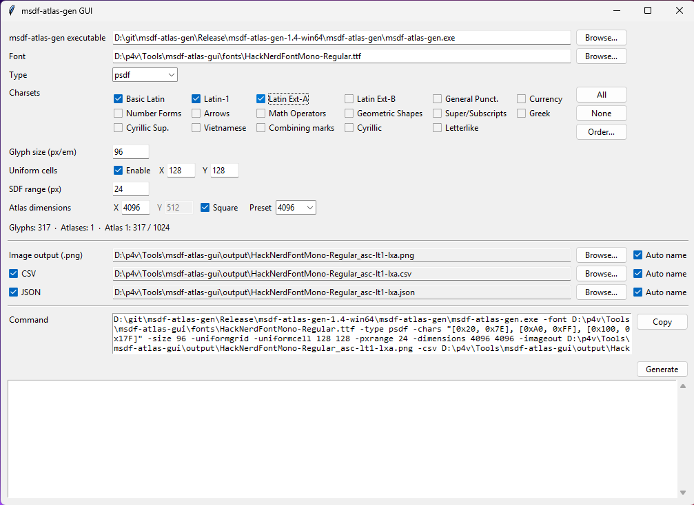
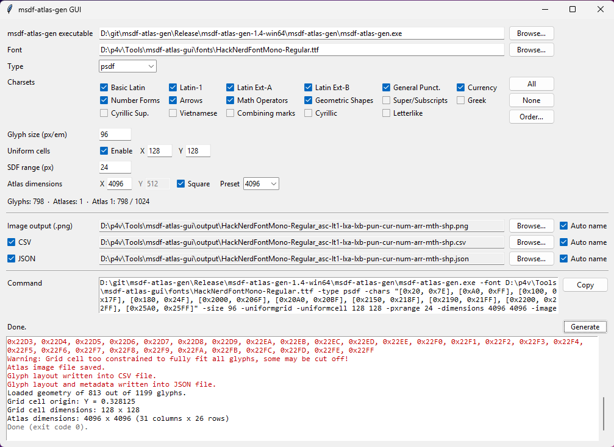
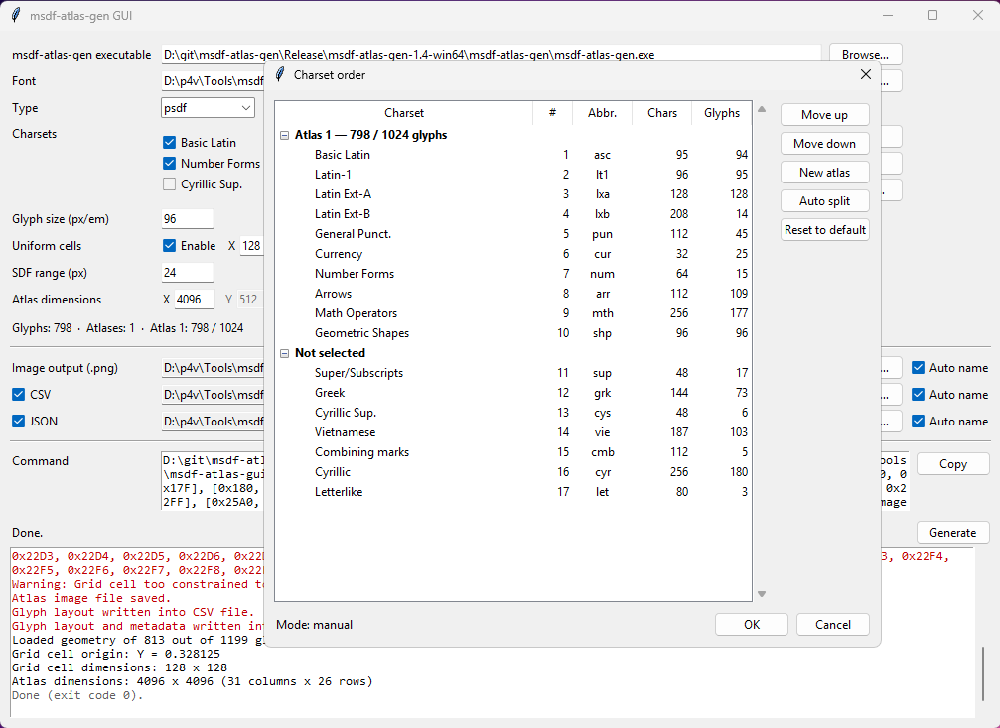
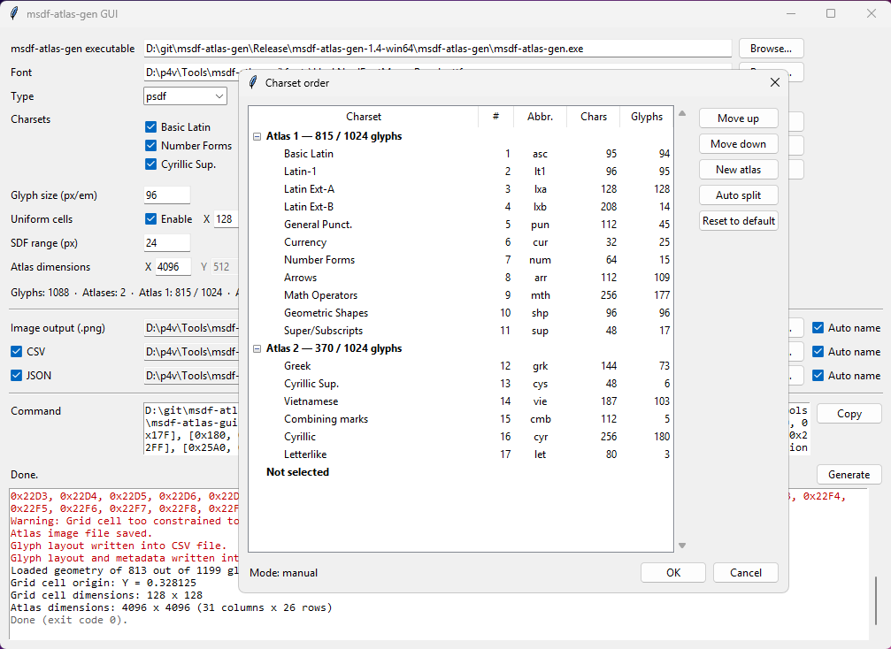

# msdf-atlas-gui

A simple Windows GUI for [msdf-atlas-gen](https://github.com/Chlumsky/msdf-atlas-gen).
It builds the msdf-atlas-gen command line from a form, shows it, and runs it. Large character sets can be split automatically across several atlases.



## Requirements

| Dependency | Notes |
|---|---|
| **Python 3** with **Tkinter** | Tkinter ships with the standard python.org Windows installer ("tcl/tk and IDLE" option). |
| **msdf-atlas-gen** executable | Download a release from [msdf-atlas-gen releases](https://github.com/Chlumsky/msdf-atlas-gen/releases). Used with version 1.4 (Windows x64). |

No pip packages are required: the tool only uses the Python standard library.

## Usage

```
python msdf_atlas_gui.py
```

1. Set the path to `msdf-atlas-gen.exe` (once, it is remembered).
2. Pick a font (`.ttf` / `.otf`).
3. Choose the atlas type, the charsets and the glyph / atlas settings.
4. Check the generated command, then click **Generate**.

All settings are saved to `settings.json` next to the script when generating and when closing the window.

## Main window



| Field | msdf-atlas-gen option |
|---|---|
| msdf-atlas-gen executable | — |
| Font | `-font` |
| Type (hardmask, softmask, sdf, psdf, msdf, mtsdf) | `-type` |
| Charsets | `-chars` |
| Glyph size (px/em) | `-size` |
| Uniform cells: Enable + X / Y | `-uniformgrid -uniformcell X Y` |
| SDF range (px) | `-pxrange` |
| Atlas dimensions X / Y, Square, Preset (256 to 4096) | `-dimensions X Y` (Square: `X X`) |
| Image output (.png) | `-imageout` |
| CSV | `-csv` |
| JSON | `-json` |

- **Info line**: total glyphs, number of atlases and, for each atlas, glyphs used / grid capacity (`floor(X / cellX) × floor(Y / cellY)`). Glyph counts are read from the font itself, so only glyphs that actually exist in the font are counted (approximate for CFF-based `.otf` fonts). Layout errors are shown in red.
- **Command**: read-only preview of the command(s), one line per atlas. **Copy** puts it on the clipboard.
- **Log**: msdf-atlas-gen output. Everything msdf-atlas-gen writes to stderr is shown in red, including normal messages such as "Atlas image file saved.".

## Charsets

Charsets are Unicode blocks, ordered by default from the most to the least common for a European user:

| Charset | Abbr. | Range |
|---|---|---|
| Basic Latin | `asc` | U+0020–U+007E |
| Latin-1 | `lt1` | U+00A0–U+00FF |
| General Punct. | `pun` | U+2000–U+206F |
| Currency | `cur` | U+20A0–U+20BF |
| Latin Ext-A | `lxa` | U+0100–U+017F |
| Latin Ext-B | `lxb` | U+0180–U+024F |
| Greek | `grk` | U+0370–U+03FF |
| Cyrillic | `cyr` | U+0400–U+04FF |
| Letterlike | `let` | U+2100–U+214F |
| Super/Subscripts | `sup` | U+2070–U+209F |
| Number Forms | `num` | U+2150–U+218F |
| Arrows | `arr` | U+2190–U+21FF |
| Math Operators | `mth` | U+2200–U+22FF |
| Geometric Shapes | `shp` | U+25A0–U+25FF |
| Cyrillic Sup. | `cys` | U+0500–U+052F |
| Vietnamese | `vie` | Full Vietnamese alphabet (see below) |
| Combining marks | `cmb` | U+0300–U+036F |

**Vietnamese** works on its own: A–Z, a–z, the accented vowels from Latin-1, ă đ ĩ ũ (Latin Ext-A), ơ ư (Latin Ext-B), the precomposed toned vowels U+1EA0–U+1EF9 and the đồng sign ₫. Combining marks are not included: without anchor positioning they render at the wrong place. They remain available through the *Combining marks* charset.

**All** / **None** tick or untick every charset. **Order…** opens the charset order window.

## Charset order and multiple atlases



The **Charset order** window lists the selected charsets grouped by atlas, followed by the unselected ones.

- Columns: order (#), abbreviation, number of codepoints in the block (**Chars**) and number of glyphs present in the font (**Glyphs**).
- Reorder with **Move up** / **Move down** or by drag and drop.
- **New atlas** adds an empty atlas section. Moving a charset to another atlas switches to **manual** mode.
- **Auto split** (auto mode) fills atlas 1 in the displayed order, then atlas 2, and so on, without ever splitting a charset across two atlases.
- **Reset to default** restores the default order and switches back to auto mode.



The order only affects the checkbox layout, the output names and the split between atlases. Inside an atlas, msdf-atlas-gen always places glyphs by ascending codepoint.

When there are several atlases, one msdf-atlas-gen command is run per atlas, one after the other. Generation stops at the first command that fails.

## Output names

With **Auto name** ticked, files are named `<FontName>_<abbreviations>.png`, for example `HackNerdFontMono-Regular_asc-lt1-lxa.png`.

- If every charset is selected in a single atlas: `<FontName>_all.png`.
- With several atlases, `_1`, `_2`… is appended to each file.
- CSV and JSON use the image name unless their own **Auto name** is unticked.
- The output folder is kept; only the file name is automatic. Default folder: `output`.

## Paths

Relative paths are resolved from the folder that contains `msdf_atlas_gui.py`, wherever the tool is launched from. msdf-atlas-gen is run with this folder as its working directory.

## msdf-atlas-gen behaviour

- **Atlas too small**: `Error: Could not fit N out of M glyphs into the atlas.`, exit code 1 and **no file is written**. A previous atlas with the same name stays in the output folder.
- **Cell too small for a glyph**: `Warning: Grid cell too constrained to fully fit all glyphs, some may be cut off!` The atlas is still generated.
- The log always shows `Loaded geometry of X out of Y glyphs.`, followed by the list of codepoints missing from the font.

## License

MIT — see [LICENSE](LICENSE).
